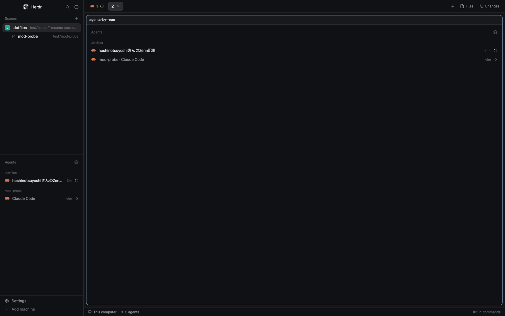

# herdr-agents-by-repo

A [Herdr](https://herdr.dev/) mod: the sidebar's Agents list, grouped by git repository instead of by space, so agents running in worktree spaces sit under their repository.



## Install

```sh
git clone <this repo> ~/dev/oss/herdr-agents-by-repo
ln -s ~/dev/oss/herdr-agents-by-repo/mods/agents-by-repo ~/.config/herdr-app/mods/agents-by-repo
herdr-app check ~/.config/herdr-app/mods/agents-by-repo
```

Herdr's layouts are read-only. To use the mod in the sidebar, clone your layout and point its Agents block at it:

```sh
herdr-app do layout.clone '{"name":"main","as":"main-by-repo"}'
# in ~/.config/herdr-app/layouts/main-by-repo.json, change the Agents block's "mod": "agents" to "agents-by-repo"
```

To try it without touching a layout: `herdr-app do tab.new '{"mod":"agents-by-repo"}'`.

See [RECIPE.md](RECIPE.md) for what it does and how it is built.

## License

Apache License 2.0. `mods/agents-by-repo/main.js` is a modified copy of the `agents` mod shipped with Herdr.app; see [NOTICE](NOTICE).
