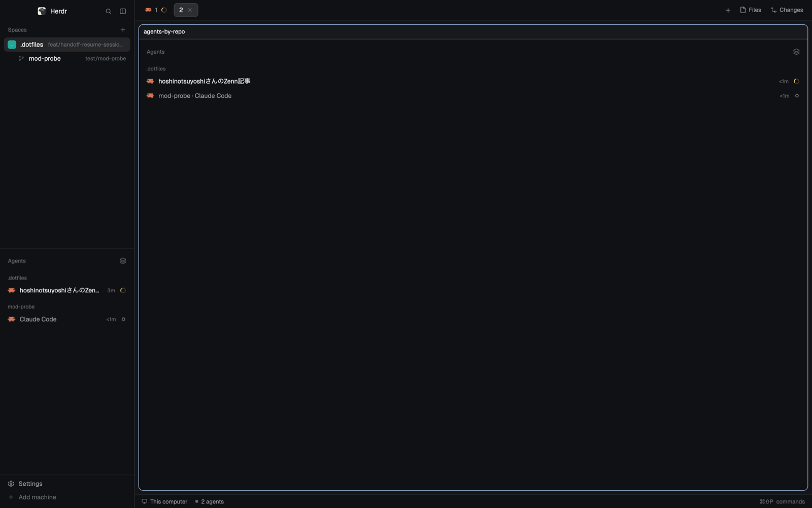

# Agents by repo

The Agents list from Herdr's sidebar, but in the "Grouped by space" view an agent is listed under its git repository. Agents running in a worktree's space join the group of the repository they belong to instead of getting a group of their own.

**What you see:** the same list as Herdr's `agents` mod (header, sort toggle, rows with icon, title, age and status). In "Grouped by space", each group header is a repository name (the main checkout's folder name, e.g. `.dotfiles`). A row whose space is not named like that group (a worktree space such as `mod-probe`) reads `<space name> · <title>`.

**How it behaves:** for each agent the mod reads its pane's live folder (`panes()[i].cwd`) and runs `git rev-parse --path-format=absolute --git-common-dir` there once per folder, cached. Worktrees of one repository share that common dir, so they share a group. Until the lookup returns, the agent stays in its space's group. Each repository gets its own group. Groups are built from all agents, not only neighbours, and `setAgentOrder` is set to the order shown (except on the narrow rail, which keeps the shipped order), so `agent.next` / `agent.prev` follow the list.

**Built from:** a copy of Herdr's shipped `agents` mod (0.1.15) with these changes: `exec` imported from `herdr`; a `repoOf(cwd, cx)` method with a per-folder cache; a `repoGroup(a)` helper in `render`; the grouped branch of the group loop keyed by repository; the row name prefixed with the space name when it differs from the group label. `mod.json`: `{ "place": "none", "title": "Agents" }`.

**Watch out:** Herdr's own layouts are read-only, so to put this in the sidebar you clone the layout (`herdr-app do layout.clone '{"name":"main","as":"<yours>"}'`) and change the Agents block's `content.mod` to `agents-by-repo`; a cloned layout no longer follows Herdr's updates. This mod is a copy of the shipped one, so it does not get Herdr's later fixes to `agents` either. Grouping is per repository: separate repositories that belong to one project stay separate groups.

**Done when:** `herdr-app check ~/.config/herdr-app/mods/agents-by-repo` passes; with a repository's space and one of its worktree spaces each running an agent, the grouped view shows one group named after the repository holding both agents, the worktree one as `<worktree space> · <title>`; a second repository's agent gets a group of its own.
